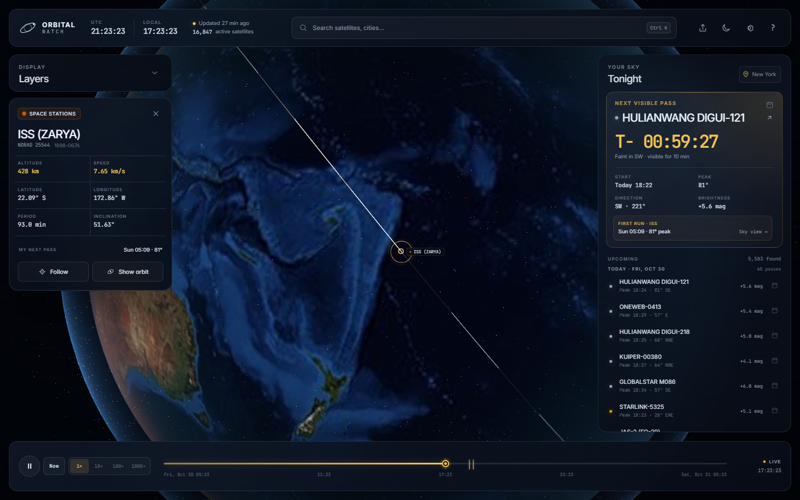

# Orbital Watch (React)

A local-first, live 3D satellite tracker and visible-pass planner rewritten as a modern React application with TypeScript and Vite. It runs entirely on your machine, renders all active objects tracked by CelesTrak in real time on an interactive 3D Earth, and predicts visible passes from your location.



## Run it

```bash
npm install
npm run dev
```

The Vite development server runs at `http://0.0.0.0:3000`. You can also build and run tests:

```bash
npm run build
npm test
```

The application is built with React 19, TypeScript, Three.js, and Vite.

## What it does

- Draws every active satellite in the local CelesTrak `GROUP=active` catalog as a
  soft glowing, group-coloured point on a real Earth.
- Uses a day/night shader driven by the Sun's position, NASA night lights, a
  procedural atmosphere and a local starfield.
- Updates positions in a Web Worker with a custom SGP4/SDP4 implementation. The
  main thread interpolates a smooth camera and can hold 60 fps while all active
  objects are on screen.
- Uses GPU picking (an off-screen ID render pass) for hover labels and selection.
- Draws a selected satellite's orbit, a fading wake, and its ground track.
- Predicts visible passes: peak elevation, direction, brightness, duration and
  the next opportunity. The sky view plots the pass on a compass/elevation chart
  and previews the satellite along it.
- Exports a clean PNG of the live WebGL view with the selected satellite and UTC
  time, and writes standards-compliant `.ics` calendar events for every pass.
- Works from the local cache when there is no internet. Data age and offline state
  are shown explicitly.

## Data and caching

The server calls CelesTrak's public GP endpoint (no API key):

```
https://celestrak.org/NORAD/elements/gp.php?GROUP=active&FORMAT=json
```

The normalized snapshot is stored in `data/gp-cache.json`. On each `/api/gp`
request the server reuses that cache unless it is at least six hours old; if it is
older, it makes one upstream request and writes the refreshed cache atomically. A
failed refresh never replaces the cache, so the app continues to work offline and
reports the cache age. The browser also has a static fallback route,
`/data/gp-fallback.json`, which is served from the same local cache file.

The bundled snapshot was downloaded directly from the CelesTrak active GP endpoint
on 2026-10-30 and contains all 16,847 active objects returned at that time. Epochs
come from CelesTrak; the server refreshes the snapshot when it is older than six
hours.

### Location and pass model

Passes use the observer's WGS-84 position and SGP4's TEME positions rotated into
ECEF by Greenwich sidereal time. A pass is listed only when:

- its peak elevation is at least 10°;
- the observer's Sun altitude is below −6°;
- the satellite is sunlit at the peak; and
- the estimated visual magnitude is no fainter than +6.5.

Brightness is an approximate standard-magnitude estimate using a group-typical
intrinsic magnitude and the phase angle. It is useful for ranking and for an
at-a-glance brightness label, not as a photometric measurement. The nearest 60
visible passes in the next 24 hours are shown, grouped by local day; if there are
none, the scanner extends its search across the following days.

The top bar's **LOCAL** clock is the device's local time. Pass days are grouped in
the device's local time zone. Location coordinates are stored only in the
browser's `localStorage`; pass computations run locally.

## SGP4 implementation

`src/lib/sgp4.js` is a from-scratch JavaScript implementation of the equations in
Vallado, Crawford, Hujsak & Kelso, *Revisiting Spacetrack Report #3*
(AIAA 2006-6753), using the WGS-72 gravity constants and AFSPC operation mode. It
implements both the near-Earth SGP4 path and the deep-space SDP4 additions
(lunar–solar perturbations, 12-hour and 24-hour resonances, Lyddane handling,
and the numerical resonance integrator). No orbit or SGP4 library is used at
runtime.

```bash
npm test
```

The test suite parses the official `SGP4-VER.TLE` and all 32 official ephemeris
files from the AIAA verification package. All **640 valid position vectors across
the 31 position-bearing cases** pass with a maximum position error of
`3.321e-8 km`, far below the required 1 km. Case `33334` is the deliberately
pathological, unphysical case that the reference driver itself replaces with the
previous data line; the suite asserts that this case is rejected by SGP4 rather
than pretending its missing state is a normal position. The exact fixture and
its provenance are in `tests/fixtures/sgp4/`.

An independent check against the public [wheretheiss.at](https://wheretheiss.at)
ISS API is included:

```bash
npm run compare:iss
```

The recorded comparison is in `proof/iss-comparison.json`; at
`2026-10-30T21:08:21Z` the 3-D position difference was **2.19 km** (2.05 km on
the ground track, 0.01 km in altitude) using a then ten-hour-old TLE. This is a
cross-check against an independent public source, not an input to the app.

## Proof

```bash
npm test
npm run compare:iss
npm run test:e2e
```

If Google Chrome is not installed, install Playwright's bundled Chromium first
with `npx playwright install chromium`; the proof script falls back to it.

The Playwright script opens the production app, sets a location, finds and
selects the ISS, opens the sky view, and writes desktop and phone screenshots
under `proof/`. It fails on any browser console error or uncaught page error.
The captured report is `proof/report.json`, which includes the active/drawn
satellite counts and measured frame rate. The proof run uses installed Google
Chrome when available (hardware WebGL); otherwise it falls back to Playwright's
Chromium.

At the final proof run, **16,847 satellites are drawn** and the tracker measures
**60 fps** in Chrome on the test machine (the browser's animation frame cap).

## Controls

| Input | Action |
| --- | --- |
| `Space` | Play / pause |
| `N` | Return to live time |
| `F` | Follow the selected satellite |
| `O` | Toggle the selected orbit |
| `L` | Toggle labels |
| `?` | Open the keyboard shortcut sheet |
| `Ctrl+K` / `Cmd+K` | Open the command palette |
| `Esc` | Close the topmost dialog |

Drag to orbit, scroll/pinch to zoom, click a satellite to select it, and hover a
satellite for its name and current altitude. On phones the side panels become
swipe-dismissable bottom sheets; the sky view is a full-screen, high-contrast
chart intended for outdoor use.

Time controls include 1×, 10×, 100×, and 1000× speeds, a scrubbable 24-hour
timeline with visible-pass markers, and a **Now** button that reconnects to live
time. Settings cover metric/imperial units, 12/24-hour clocks, and reduced motion.
All settings and the chosen location persist locally.

## Sources and licences

All map, texture and font assets are stored locally in this repository. There are
no map tiles, geocoders, or external icon requests at runtime. The only runtime
network request is the optional CelesTrak GP refresh, which falls back to the
cached catalog when the network is unavailable.

- **Satellite GP data** — [CelesTrak](https://celestrak.org), Dr. T.S. Kelso, public
  GP data (`GROUP=active`). Runtime source:
  <https://celestrak.org/NORAD/elements/gp.php?GROUP=active&FORMAT=json>. CelesTrak's
  [usage policy](https://celestrak.org/usage-policy.php) applies to the data.
  The bundled snapshot was fetched directly from this endpoint on 2026-10-30.
- **SGP4 verification data** — Vallado, Crawford, Hujsak & Kelso, *Revisiting
  Spacetrack Report #3*, AIAA 2006-6753; the official test TLE and ephemeris
  vectors distributed with the paper (AIAA-2006-6753.zip, CelesTrak Software).
  Files are retained in `tests/fixtures/sgp4/` with their original reference readme.
- **Day texture** — NASA Blue Marble Next Generation, August 2004, topography and
  bathymetry, NASA Earth Observatory / NASA Science. Public domain. Source:
  <https://science.nasa.gov/earth/earth-observatory/blue-marble/> (local
  4096 × 2048 copy in `public/assets/textures/earth_day.jpg`).
- **Night texture** — NASA Earth Observatory, *Earth at Night* (Suomi NPP VIIRS,
  2012), NASA/NOAA NGDC. Public domain. Source:
  <https://earthobservatory.nasa.gov/features/NightLights> (local 3600 × 1800 copy
  in `public/assets/textures/earth_night.jpg`).
- **City list** — Natural Earth 1:10m Populated Places (public domain),
  <https://www.naturalearthdata.com/downloads/10m-cultural-vectors/10m-populated-places/>,
  retrieved from the Natural Earth vector repository. Reduced to
  name/administrative area/country/population/coordinates in
  `public/data/cities.json`.
- **Inter** — © Rasmus Andersson, SIL Open Font License 1.1. The local Latin
  Web font and full licence are in `public/assets/fonts/` (`Inter-LICENSE.txt`).
  Source: <https://github.com/rsms/inter>.
- **JetBrains Mono** — JetBrains, SIL Open Font License 1.1. Local Latin Web font
  and licence are in `public/assets/fonts/` (`JetBrainsMono-LICENSE.txt`).
  Source: <https://github.com/JetBrains/JetBrainsMono>.
- **three.js** — MIT, <https://github.com/mrdoob/three.js>. The only 3D library.
- **Vite** — MIT build tool. **Playwright** — Apache-2.0, used only for the
  automated visual proof. Neither ships in the application.
- **Starfield, atmosphere, favicon, charts and UI icons** — generated or drawn for
  this project. No third-party icon set is used.
- **Independent ISS cross-check** — [wheretheiss.at](https://wheretheiss.at),
  public API, used only by `scripts/compare-iss.mjs`.

All bundled textures and map data have public-domain provenance. Fonts are used
under the SIL Open Font License; the full licence texts are included beside the
fonts.

## Layout

```
server/            local static server, CelesTrak cache and normaliser
src/lib/           catalog grouping, formatting, SGP4, pass prediction
src/scene/         three.js globe, Earth shaders, satellites, GPU picking
src/workers/       position propagation and all-sky pass scanner
src/main.js        application state, panels, timelines, dialogs and proof hooks
src/style.css      responsive mission-control interface
data/              atomically refreshed CelesTrak cache
public/data        bundled city list
public/assets      public-domain textures and OFL fonts
tests/             official SGP4 verification suite and fixtures
scripts/           Playwright proof and independent ISS comparison
proof/             screenshots and machine-readable proof reports
```
